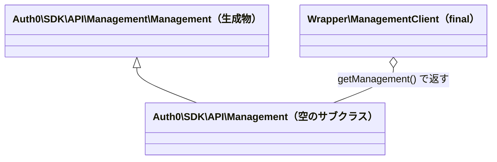

# SOW: auth0/auth0-php 9.x 対応（ray/auth0-module 6.0.0）

- 対象 Issue: #18「auth0/auth0-php 9.x に対応する（6.0.0）」
- 作成日: 2026-11-16
- 状態: ドラフト（「5. 要判断事項」は 2026-11-16 に推奨案で決定しました。Issue #18 の訂正も同日に反映済みです）
- タスク一覧: [TASKS.md](./TASKS.md)

## 1. 目的

`auth0/auth0-php` 9.x と組み合わせて動く `ray/auth0-module` 6.0.0 をリリースします。
利用各媒体（SPUR / UOMO / Seventeen / ÉCLAT / BAILA / MAQUIA / タグ管理システム）が 9.x へ上げるための前提作業です。

## 2. 現状

### モジュールの構成（5.0.0 / master `6a27b37`）

| クラス | 役割 | 9.x での扱い |
|---|---|---|
| `Auth0Module` | `Management` / `Authentication` / `AuthInterface` などを束縛します。 | 束縛する `Management` の型を見直します。 |
| `ManagementClientProvider` | `new Management(new SdkConfiguration($config))` で生成します。 | 9.x では TypeError になるため、作り直します。 |
| `AuthenticationClientProvider` | `new Authentication($config)`（`STRATEGY_NONE`）で生成します。 | 変更不要です。 |
| `Auth` | `SdkConfiguration`（`STRATEGY_API`）と `Token` でトークンを検証します。 | 変更不要です。 |
| `FakeManagementClientProvider`（tests） | 本物の Provider と同じ内容の複製です。 | 本物に合わせて作り直すか、廃止します。 |

### 9.6.0 のソースで確認できたこと

SDK 9.6.0 と 9.0.0 を作業用ディレクトリに取得し、ソースを読んで確認しました。

- `SdkConfiguration` の `STRATEGY_*` 定数と、`Authentication` のコンストラクタ（`SdkConfiguration | array`）は 8.x と同じです。
- `Wrapper\ManagementClient` / `ManagementClientOptions` / `TokenProvider` は 9.0.0 の時点で存在し、`tokenCache` も 9.0.0 から使えます。
  したがって、制約は `^9.0` で足ります。
- 9.x の PHP 要件は `^8.2` で、本モジュールの要件および CI のマトリクス（8.2 / 8.3 / 8.4）と一致します。
- 本モジュールの `composer.json` で `auth0/auth0-php` を `^9.0` に変えても、依存は解決できます（PHP 8.3 での dry-run で確認）。
- Management API 用トークンは、最初の API 呼び出し時に取得されます。
  クライアントを生成しただけでは通信が発生しないため、テストで実インスタンスを生成できます。

## 3. Issue の記述と実ソースの相違

Issue #18 の記述のうち、9.6.0 のソースと合わない点、および Issue に書かれていない注意点です。
いずれも設計に影響します。

### 3.1 Wrapper が生成するのは旧クラス名のインスタンスです

Issue には「公式の Wrapper が生成するのは新クラスなので、旧クラス名で束縛し続けるには Wrapper 相当の処理をモジュール側で作り直す必要があります」とあります。
実際には、`ManagementClient` は内部で `new Auth0\SDK\API\Management(...)`（旧クラス名）を生成し、`getManagement()` の戻り値の型も旧クラス名です（9.0.0 / 9.6.0 とも）。



旧クラスは新クラスを継承しているため、Wrapper が返すインスタンスは新旧どちらの型としても束縛できます。
つまり、旧クラス名で束縛し続けても、Wrapper の作り直しは要りません。

また、旧クラスの docblock には「`Auth0\SDK\API\Management` として import できるようにするためのクラス」「下流 SDK（auth0/login など）向けのブリッジ」と書かれており、非推奨の表記はありません。
公式の移行ガイドの 9.x 側のサンプルも `use Auth0\SDK\API\Management;` を使っています。
「互換用のクラス名は将来消える可能性がある」という Issue の根拠は、ソースからは裏付けられませんでした。

### 3.2 `ManagementClient` 自体は `Management` 型ではありません

`ManagementClient` は `final` で、`Management` を継承していません（`__get` で委譲しているだけです）。
Provider は `ManagementClient` をそのまま返せないため、`getManagement()` の戻り値を返す必要があります。

### 3.3 `ManagementClientOptions` は名前付き引数で渡す必要があります

Issue には `ManagementClientOptions(domain, clientId, clientSecret)` とあります。
実際のコンストラクタの並びは `domain, token, tokenProvider, clientId, clientSecret, audience, httpClient, timeout, maxRetries, additionalHeaders, tokenCache` です。
位置引数で渡すと `clientId` が `token` に入ってしまうため、名前付き引数を使います。

### 3.4 `domain` が正規化されなくなります

8.x の `SdkConfiguration` は、`domain` にスキーム付きの値（例: `https://example.com`）を渡してもホスト名に正規化していました。
9.x の Wrapper は、渡された文字列をそのまま `"https://{$domain}/api/v2"` と `"https://{$domain}/oauth/token"` に埋め込みます。
スキーム付きの値を渡すと `https://https://example.com/...` になり、API 呼び出しの時点で初めて失敗します。

本モジュールのテストは `'domain' => 'https://example.com'` を渡しています。
媒体側の設定にもスキーム付きの値がある可能性があります（未確認）。

### 3.5 Issue 内の記述の不整合

「新しい設定キーや環境変数は追加しません」とある一方で、対応内容には「`tokenCache`（PSR-6）を config から渡せるようにします（任意）」があります。
`tokenCache` を入れる場合は、設定キーが 1 つ増えます。

### 3.6 Issue に書かれていない挙動の変化

- Management は config の `domain` / `clientId` / `clientSecret` 以外を読まなくなります。
  8.x の `SdkConfiguration` 経由で効いていたキー（`httpClient`、`httpMaxRetries`、`managementToken`、`managementTokenCache` など）は、Management については無視されます。
- 例外の型が変わります。
  `clientId` / `clientSecret` が欠けている場合は、生成時に `InvalidArgumentException` が投げられます（8.x は `ConfigurationException`）。
  トークン取得の失敗は `RuntimeException` で、`Auth0Exception` ではありません。
- `Management` の束縛にはスコープの指定がないため、注入のたびに新しいインスタンスが作られます。
  `tokenCache` を渡さない場合、トークンはインスタンスごとのメモリにしか保持されず、注入箇所の数だけトークンを取得します。

## 4. 方針

### 4.1 `ManagementClientProvider` の作り直し

```php
// 生成の骨子（要判断事項の結論により細部は変わります）
$client = new ManagementClient(new ManagementClientOptions(
    domain: $domain,            // 正規化済みのホスト名
    clientId: $clientId,
    clientSecret: $clientSecret,
    tokenCache: $tokenCache,    // 任意
));

return $client->getManagement();
```

- config の `audience` は `ManagementClientOptions` に渡しません。
  Management API 用の audience は、SDK の既定値 `https://{domain}/api/v2/` に任せます。
- `customDomain` は、従来どおり Management には渡しません。
- `strategy` の上書きと `SdkConfiguration` の利用は、この Provider からなくなります。

### 4.2 変更しないもの

- `Auth`、`AuthenticationClientProvider`、`Extractor` 以下、例外クラスは変更しません。
- CI のワークフローは変更しません（PR #17 とは独立です）。
- `nyholm/psr7` と `guzzlehttp/guzzle` は、PSR-17 / PSR-18 の実装として引き続き必要です。

## 5. 要判断事項

2026-11-16 に、D1〜D4 のすべてを推奨案で進めることに決まりました。
以下は、判断の経緯として残しています。

### D1. 束縛する `Management` の型

| 案 | 内容 | 利用側の `use` 文 | 備考 |
|---|---|---|---|
| A（推奨） | 新クラス `Auth0\SDK\API\Management\Management` だけを束縛します。 | 書き換えが必要です。 | Issue の方針どおりです。生成物の本体の型に揃います。 |
| B | 旧クラス名 `Auth0\SDK\API\Management` だけを束縛します。 | 書き換え不要です。 | 公式の移行ガイドのサンプルと同じ書き方です。 |
| C | 新旧の両方を束縛します。 | どちらでも動きます。 | 束縛が 1 行増えるだけですが、型が二通りに割れます。 |

A を推奨します。
利用側は呼び出しの書き換えで同じファイルを必ず触るため、`use` 文の書き換えは追加の負担になりません。
ただし、3.1 のとおり Issue に書かれた根拠は事実と異なるため、A を選ぶ場合も Issue の記述は直す必要があります。

### D2. `domain` の正規化

モジュール側でスキームとパスを取り除いてホスト名にしてから渡すことを推奨します。
こうすれば、8.x で通っていた設定値が 6.0.0 でもそのまま通ります。
正規化しない場合は、媒体側の設定値の確認と、移行手順への明記が必要です。

### D3. `tokenCache` を 6.0.0 に含めるか

含めることを推奨します。
config のキーは `tokenCache`（`Psr\Cache\CacheItemPoolInterface`）とし、指定がなければ従来どおりキャッシュなしで動かします。
含める場合は、`psr/cache` を `require` に明示します（現在は 9.x の依存として間接的に入るだけです）。
あわせて、Issue の「新しい設定キーは追加しません」を直します。

### D4. `Management` の束縛を SINGLETON にするか

SINGLETON にすることを推奨します。
同一リクエスト内で複数箇所に注入しても、トークンの取得が 1 回で済みます。
5.0.0 はスコープなしなので、挙動の変更としてリリースノートに書きます。

## 6. スコープ

### 対象

- `composer.json` の制約変更
- `ManagementClientProvider` の作り直し
- `Auth0Module` の束縛の変更
- テストの更新と追加
- README の更新
- Issue #18 の記述の訂正
- 6.0.0 のリリース（タグとリリースノート）

### 対象外

- 利用各媒体の改修（各媒体の Issue で扱います）
- PR #17（GitHub Actions の Node 24 対応）
- `next` ブランチの整理
- Authentication API とトークン検証の仕様変更

## 7. 成果物

| 成果物 | 内容 |
|---|---|
| ソース | `composer.json`、`src/Auth0Module.php`、`src/Provider/ManagementClientProvider.php` |
| テスト | `tests/Auth0ModuleTest.php`、`tests/Fake/Provider/FakeManagementClientProvider.php`（廃止を含みます）、Provider の単体テスト（新規） |
| ドキュメント | `README.md`、6.0.0 のリリースノート（移行手順を含みます） |
| リリース | タグ `6.0.0` |

## 8. 完了条件

- `auth0/auth0-php` 9.x と組み合わせて、`Auth` / `Management` / `Authentication` を生成できること。
- Management API 用トークンの要求に、config の `audience` ではなく `https://{domain}/api/v2/` が使われること（テストで確認します）。
- スキーム付きの `domain` でも、正しい URL に要求が出ること（D2 で正規化を採る場合）。
- `composer tests`（phpcs / phpunit / phpstan level max）がすべて通ること。
- CI が PHP 8.2 / 8.3 / 8.4 で通ること。
- 実テナントに対して Management API を 1 回以上呼び出せること（手元での確認）。
- `6.0.0` のタグが打たれていること。

## 9. リスク

| リスク | 影響 | 対応 |
|---|---|---|
| 媒体側の `domain` がスキーム付きである。 | Management API の呼び出しが実行時に失敗します。 | D2 の正規化で吸収します。 |
| 媒体側が Management 向けに `httpClient` などの config キーを使っている。 | 6.0.0 では黙って無視されます。 | 媒体側の設定を確認し、必要なら対応するキーを追加します。 |
| `tokenCache` なしで運用する。 | リクエストごとにトークンを取得し、Auth0 の M2M トークンの発行数が増えます。 | 8.x でもキャッシュ未設定なら同じ挙動です。D3 と D4 で軽減します。 |
| PHPStan level max で、生成物の型に起因するエラーが出る。 | `composer tests` が通りません。 | Provider の戻り値の型を束縛の型に合わせ、必要な範囲だけ対処します。 |
| 実テナントでの確認ができない。 | 単体テストだけでは通信経路を保証できません。 | 検証用のテナントと M2M アプリケーションの有無を事前に確認します。 |

## 10. 未確認事項

- 各媒体の config の `domain` の書式（スキームの有無）
- 各媒体が Management 向けに使っている config キーの有無
- 実テナントでの確認に使える検証環境の有無
- `tokenCache` に渡す PSR-6 実装を、媒体側が用意できるかどうか
