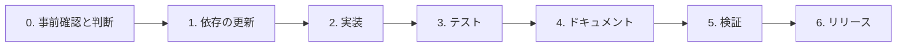

# TASKS: auth0/auth0-php 9.x 対応（ray/auth0-module 6.0.0）

- 対象 Issue: #18
- 前提: [SOW.md](./SOW.md)
- 作成日: 2026-11-16

D1〜D4 は SOW「5. 要判断事項」の番号です。
各タスクは、SOW の推奨案（D1 = 新クラスのみ、D2 = 正規化する、D3 = 含める、D4 = SINGLETON）を前提に書いています。
結論が変わった場合は、該当タスクを見直します。

## 進め方

## 0. 事前確認と判断

- [x] 0-1. D1（束縛する型）を決めます。→ 新クラスのみ
- [x] 0-2. D2（`domain` の正規化）を決めます。→ 正規化する
- [x] 0-3. D3（`tokenCache` を含めるか）を決めます。→ 含める
- [x] 0-4. D4（SINGLETON にするか）を決めます。→ SINGLETON にする
- [ ] 0-5. 各媒体の config を確認します。
  - `domain` にスキームが付いているか。
  - Management 向けに `httpClient` / `httpMaxRetries` / `managementToken` / `managementTokenCache` などを渡しているか。
- [ ] 0-6. 実テナントでの確認に使える検証環境（テナントと M2M アプリケーション）があるかを確認します。
- [x] 0-7. Issue #18 の記述を訂正します。
  - 「Wrapper が生成するのは新クラス」という根拠（SOW 3.1）
  - `ManagementClientOptions(domain, clientId, clientSecret)` の書き方（SOW 3.3）
  - 「新しい設定キーは追加しません」と `tokenCache` の不整合（SOW 3.5）
  - `domain` の正規化と、無視される config キーの追記（SOW 3.4 / 3.6）

## 1. 依存の更新

- [x] 1-1. master から作業ブランチを作ります（`feature/auth0-php-9`）。
- [ ] 1-2. `composer.json` の `auth0/auth0-php` を `^9.0` にします。
- [ ] 1-3. D3 で含める場合、`psr/cache` を `require` に追加します。
- [ ] 1-4. `composer update` を実行し、依存が解決できることを確認します。
  - PHP 8.3 での dry-run では解決できています。
- [ ] 1-5. この時点で `composer tests` を実行し、壊れる箇所を記録します。
  - `ManagementClientProvider` と `FakeManagementClientProvider` が壊れる見込みです。

## 2. 実装

- [ ] 2-1. `src/Provider/ManagementClientProvider.php` を作り直します。
  - `ManagementClient(new ManagementClientOptions(...))` を名前付き引数で生成します。
  - `getManagement()` の戻り値を返します。
  - config の `audience` と `customDomain` は渡しません。
  - `SdkConfiguration` と `strategy` の上書きを削除します。
  - `@implements ProviderInterface<...>` と戻り値の型を、D1 の型に合わせます。
- [ ] 2-2. `domain` の正規化を実装します（D2）。
  - スキーム付き、スキームなし、末尾スラッシュ付きのいずれもホスト名にします。
  - 空文字やホスト名を取り出せない値は、生成時に例外にします。
- [ ] 2-3. config の `domain` / `clientId` / `clientSecret` の型を検証します。
  - config は `array<string, mixed>` なので、PHPStan level max を通すために文字列であることを確かめます。
  - 欠けている場合の例外の型とメッセージを決めます。
- [ ] 2-4. `tokenCache` を config から受け取れるようにします（D3）。
  - `CacheItemPoolInterface` 以外が渡された場合は例外にします。
  - `Auth` と `AuthenticationClientProvider` に渡る config に `tokenCache` が混ざっても問題がないかを確認します。
    `SdkConfiguration` が未知のキーをどう扱うかを確かめ、必要なら渡す前に取り除きます。
- [ ] 2-5. `src/Auth0Module.php` の束縛を変更します。
  - `use` 文を D1 の型に差し替えます。
  - D4 で採る場合、`->in(Scope::SINGLETON)` を付けます。

## 3. テスト

- [ ] 3-1. `tests/Fake/Provider/FakeManagementClientProvider.php` の扱いを決めます。
  - 現状は本物の Provider の複製です。
  - 9.x では生成時に通信が発生しないため、廃止して本物の Provider を使う案が有力です。
- [ ] 3-2. `tests/Auth0ModuleTest.php` を更新します。
  - `use` 文と `assertInstanceOf` の型を D1 の型に合わせます。
  - 3-1 で Fake を廃止する場合、Fake への束縛を外します。
- [ ] 3-3. `ManagementClientProvider` の単体テストを追加します。
  - 返り値が D1 の型であること。
  - スキーム付きの `domain` でも、要求先が `https://{host}/oauth/token` と `https://{host}/api/v2/...` になること。
  - トークン要求の `audience` が `https://{host}/api/v2/` であり、config の `audience` ではないこと。
  - `clientId` / `clientSecret` が欠けている場合に例外になること。
  - 検証方法は、PSR-18 のモッククライアントで要求を捕捉する形を想定しています。
    Provider にテスト用の `httpClient` を渡す経路が必要になるため、実装時に設計を決めます。
- [ ] 3-4. D3 で含める場合、`tokenCache` のテストを追加します。
  - キャッシュにトークンがあるとき、トークン要求が出ないこと。
- [ ] 3-5. D4 で採る場合、同じインスタンスが返ることをテストします。
- [ ] 3-6. `Auth` と `Authentication` が 9.x でも生成できることを確認します（既存テストで足りるかを確認します）。
- [ ] 3-7. `composer tests`（phpcs / phpunit / phpstan）をすべて通します。
- [ ] 3-8. `vendor/bin/php-cs-fixer fix --dry-run --diff` を通します。
  - CI では実行されますが、`composer tests` には含まれていません。

## 4. ドキュメント

- [ ] 4-1. README の Usage を 9.x の書き方に直します。
  - `users()->create([...])` を `users->create(new CreateUserRequestContent([...]))` にします。
  - 現在のサンプルは PHP の構文としても壊れているため、あわせて直します。
  - `use` 文を D1 の型で示します。
- [ ] 4-2. README に設定の説明を追記します。
  - `domain` の書式（D2）
  - `tokenCache`（D3）
  - Management に `audience` が使われないこと
- [ ] 4-3. 5.x から 6.0.0 への移行手順を書きます（README またはリリースノート）。
  - 型宣言の変更
  - Management API 呼び出しの書き換え（Issue #18 の対応表を流用します）
  - 無視されるようになった config キー
  - 例外の型の変化
  - D4 のスコープ変更

## 5. 検証

- [ ] 5-1. CI が PHP 8.2 / 8.3 / 8.4 で通ることを確認します。
- [ ] 5-2. 実テナントに対して、Management API を 1 回以上呼び出します（例: `users->list()`）。
- [ ] 5-3. 実テナントで、アクセストークンの検証（`Auth::verifyToken()`）が通ることを確認します。
- [ ] 5-4. 利用側の 1 媒体で、`composer require ray/auth0-module:dev-<ブランチ>` による組み込みを試します。
  - インラインエイリアス（`dev-xxx as 6.0.0`）を使う場合は、`composer depends ray/auth0-module` で逆依存を調べ、制約違反になるパッケージをタスクに明記します。

## 6. リリース

- [ ] 6-1. プルリクエストを作成し、レビューを受けます。
- [ ] 6-2. master にマージします。
- [ ] 6-3. `6.0.0` のタグを打ち、リリースノートを公開します。
- [ ] 6-4. 各媒体の Issue に、6.0.0 のリリースと移行手順を連絡します。
- [ ] 6-5. Issue #18 を閉じます。

## 補足

- `git push` は利用者が行います。
- `var/` は `.gitignore` に入っていないため、このディレクトリのファイルは未追跡ファイルとして現れます。
